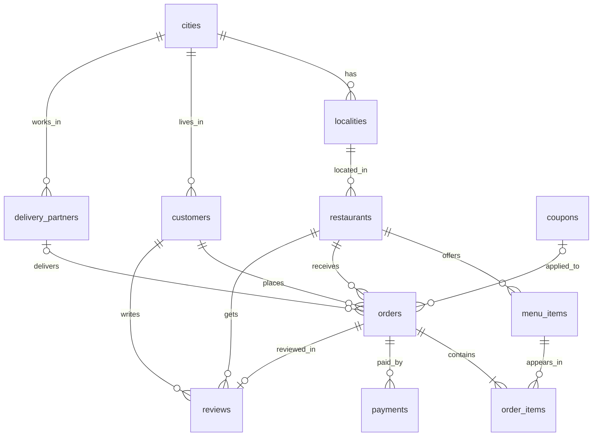

# Phase 2: Schema Design

All 11 tables live in a schema called `zomato`. The schema is in `sql/01_schema.sql` and the load script is in `sql/02_load_data.sql`. Table and column names are exactly the CSV file names and headers, because the 30 queries depend on them.

## 1. Data dictionary

### cities
| Column | Type | Constraint | Why |
|---|---|---|---|
| city_id | INTEGER | PRIMARY KEY | Identifies a city. |
| city_name | VARCHAR(50) | NOT NULL, UNIQUE | Every city has a name, and two cities cannot share one. |
| state | VARCHAR(50) | NOT NULL | Not unique, because Maharashtra has two cities (Mumbai and Pune). |

### localities
| Column | Type | Constraint | Why |
|---|---|---|---|
| locality_id | INTEGER | PRIMARY KEY | Identifies a neighbourhood. |
| city_id | INTEGER | NOT NULL, FK to cities, ON DELETE RESTRICT | Every locality belongs to one city. A city that still has localities cannot be deleted. |
| locality_name | VARCHAR(60) | NOT NULL | Display name. |
| pincode | CHAR(6) | NOT NULL, CHECK 6 digits | A pincode is a fixed-length code, not a number, so we do no maths on it and keep it as text. |
| (city_id, locality_name) | | UNIQUE | The same locality name cannot appear twice in one city. |

### customers
| Column | Type | Constraint | Why |
|---|---|---|---|
| customer_id | INTEGER | PRIMARY KEY | Identifies a customer. |
| full_name | VARCHAR(100) | NOT NULL | Needed on bills and support screens. Not unique: 25,000 customers share only 500 names. |
| email | VARCHAR(100) | NOT NULL, UNIQUE, CHECK contains '@' | A natural candidate key. There are no duplicates in the data. |
| phone | CHAR(10) | NOT NULL, UNIQUE, CHECK 10 digits | A natural candidate key, kept as text so that nothing is lost. |
| city_id | INTEGER | NOT NULL, FK to cities, ON DELETE RESTRICT | The city the customer lives in. |
| signup_date | DATE | NOT NULL | A date with no time of day. |
| is_gold_member | BOOLEAN | NOT NULL, DEFAULT FALSE | Yes/no flag, stored as t/f in the CSV. |
| gold_expires_on | DATE | NULL allowed | Empty for non-Gold customers. |
| is_active | BOOLEAN | NOT NULL, DEFAULT TRUE | Yes/no flag. |
| (rule) | | CHECK: a Gold member must have an expiry date | In the data, every Gold member has a date, and every non-Gold customer has none. We do not force the date to be empty for non-Gold users, because query W05 sets is_gold_member to FALSE and leaves the old date in place. |

### restaurants
| Column | Type | Constraint | Why |
|---|---|---|---|
| restaurant_id | INTEGER | PRIMARY KEY | Identifies a restaurant. |
| name | VARCHAR(100) | NOT NULL | Display name. |
| locality_id | INTEGER | NOT NULL, FK to localities, ON DELETE RESTRICT | A restaurant sits in one locality. Its city comes through the locality. |
| cuisines | TEXT[] | NOT NULL | A restaurant serves several cuisines, so this is an array. R25 searches it with ANY. |
| avg_cost_for_two | INTEGER | NOT NULL, CHECK > 0 | Whole rupees, always positive. |
| rating | NUMERIC(2,1) | NULL allowed, CHECK between 1 and 5 | 124 restaurants have no rating yet, so it is empty. One decimal place, like 4.3. |
| rating_count | INTEGER | NOT NULL, DEFAULT 0, CHECK >= 0 | A count can never be negative. |
| opens_at, closes_at | TIME | NOT NULL, CHECK opens_at < closes_at | Opening hours are a time of day, not a timestamp. |
| is_pure_veg | BOOLEAN | NOT NULL | Yes/no flag. |
| status | VARCHAR(25) | NOT NULL, CHECK in OPEN, TEMPORARILY_CLOSED, DELISTED | Only these three values appear. |
| onboarded_on | DATE | NOT NULL | A date with no time of day. |

### menu_items
| Column | Type | Constraint | Why |
|---|---|---|---|
| item_id | INTEGER | PRIMARY KEY | Identifies a dish. |
| restaurant_id | INTEGER | NOT NULL, FK to restaurants, ON DELETE CASCADE | A dish belongs to exactly one restaurant and means nothing without it. Order lines point to dishes with RESTRICT, so a dish that was ever ordered cannot disappear. |
| item_name | VARCHAR(100) | NOT NULL | Display name. |
| category | VARCHAR(30) | NOT NULL, CHECK in 6 allowed values | Main Course, Breads, Rice, Desserts, Beverages, Starters. |
| price | NUMERIC(10,2) | NOT NULL, CHECK > 0 | Money uses NUMERIC, never FLOAT, so there are no rounding errors. |
| is_veg | BOOLEAN | NOT NULL | Yes/no flag. |
| is_bestseller | BOOLEAN | NOT NULL, DEFAULT FALSE | Yes/no flag. |
| is_available | BOOLEAN | NOT NULL, DEFAULT TRUE | Yes/no flag. W03 sets it to FALSE when a dish sells out. |

### delivery_partners
| Column | Type | Constraint | Why |
|---|---|---|---|
| partner_id | INTEGER | PRIMARY KEY | Identifies a rider. |
| full_name | VARCHAR(100) | NOT NULL | Needed on dispatch and fleet screens. |
| phone | CHAR(10) | NOT NULL, UNIQUE, CHECK 10 digits | A natural candidate key. |
| city_id | INTEGER | NOT NULL, FK to cities, ON DELETE RESTRICT | The city the rider works in. |
| vehicle_type | VARCHAR(15) | NOT NULL, CHECK in SCOOTER, BICYCLE, BIKE, EV | Only these four values appear. |
| joined_on | DATE | NOT NULL | A date with no time of day. |
| rating | NUMERIC(2,1) | NOT NULL, CHECK between 1 and 5 | Every rider has a rating in the data. |
| status | VARCHAR(15) | NOT NULL, CHECK in ACTIVE, INACTIVE, BLOCKED | Only these three values appear. |

### coupons
| Column | Type | Constraint | Why |
|---|---|---|---|
| coupon_code | VARCHAR(20) | PRIMARY KEY | The code itself is the natural key, and orders refer to it. |
| discount_pct | SMALLINT | NOT NULL, CHECK between 1 and 100 | A small whole number is enough. |
| max_discount | NUMERIC(10,2) | NOT NULL, CHECK > 0 | Money, so NUMERIC. |
| min_order_value | NUMERIC(10,2) | NOT NULL, CHECK >= 0 | Money, and 0 means no minimum. |
| valid_from, valid_to | DATE | NOT NULL, CHECK valid_from <= valid_to | A coupon cannot expire before it starts. |

### orders
| Column | Type | Constraint | Why |
|---|---|---|---|
| order_id | INTEGER | PRIMARY KEY | Identifies an order. |
| customer_id | INTEGER | NOT NULL, FK to customers, ON DELETE RESTRICT | Every order has a customer. Customers with orders cannot be deleted, so billing history is kept. |
| restaurant_id | INTEGER | NOT NULL, FK to restaurants, ON DELETE RESTRICT | Every order comes from a restaurant. Same reason as above. |
| partner_id | INTEGER | NULL allowed, FK to delivery_partners, ON DELETE RESTRICT | Empty until a rider is assigned (13,538 orders). |
| coupon_code | VARCHAR(20) | NULL allowed, FK to coupons, ON DELETE RESTRICT | Empty when no coupon was used (129,792 orders). |
| placed_at | TIMESTAMPTZ | NOT NULL | Every order has a placement time. TIMESTAMPTZ because the CSV has a +05:30 offset. |
| accepted_at, picked_up_at, delivered_at | TIMESTAMPTZ | NULL allowed | Filled in only as the order progresses, so they depend on status. |
| distance_km | NUMERIC(4,1) | NOT NULL, CHECK > 0 | One decimal place, like 9.0. |
| item_total | NUMERIC(10,2) | NOT NULL, CHECK > 0 | Money. |
| delivery_fee | NUMERIC(10,2) | NOT NULL, CHECK >= 0 | 0 for Gold members (free delivery). |
| discount | NUMERIC(10,2) | NOT NULL, DEFAULT 0, CHECK >= 0 | 0 when there is no coupon. |
| total_amount | NUMERIC(10,2) | NOT NULL, CHECK = item_total + delivery_fee - discount | The money rule holds on all 150,000 rows. |
| status | VARCHAR(30) | NOT NULL, CHECK in 7 allowed values | PLACED, ACCEPTED, PREPARING, OUT_FOR_DELIVERY, DELIVERED, CANCELLED_BY_CUSTOMER, CANCELLED_BY_RESTAURANT. |

Time-order rules on orders (the data has no violations):
- accepted_at is not before placed_at.
- picked_up_at needs accepted_at and is not before it.
- delivered_at needs picked_up_at and is not before it.

Status-dependent NULL rules on orders, based on what the data shows:

| Status | Rule |
|---|---|
| DELIVERED | partner_id and all three timestamps are filled. |
| OUT_FOR_DELIVERY | partner_id and picked_up_at are filled, delivered_at is empty. |
| PREPARING | partner_id and accepted_at are filled, picked_up_at is empty. |
| ACCEPTED | accepted_at is filled, picked_up_at is empty. partner_id is not forced, because the dispatcher assigns it later (W02). |
| PLACED, CANCELLED_BY_RESTAURANT | partner_id and all timestamps are empty. |
| CANCELLED_BY_CUSTOMER | Not constrained. The data shows two patterns (cancelled before acceptance, and cancelled after a rider was assigned). |
| Any status | delivered_at is only allowed when status is DELIVERED. |

### order_items
| Column | Type | Constraint | Why |
|---|---|---|---|
| order_id | INTEGER | NOT NULL, FK to orders, ON DELETE CASCADE | Order lines mean nothing without their order, so they are deleted with it. |
| item_id | INTEGER | NOT NULL, FK to menu_items, ON DELETE RESTRICT | A dish that was ordered cannot be deleted. |
| (order_id, item_id) | | PRIMARY KEY (composite) | An order can contain many dishes, and a dish appears in many orders (many-to-many). Each dish appears once per order, with a quantity, and the data has no duplicates. |
| quantity | SMALLINT | NOT NULL, CHECK > 0 | Small whole number (1 to 3 in the data). |
| unit_price | NUMERIC(10,2) | NOT NULL, CHECK > 0 | The price at the time of order, kept here because menu prices can change later. |

### payments
| Column | Type | Constraint | Why |
|---|---|---|---|
| payment_id | INTEGER | PRIMARY KEY | order_id repeats (137,378 payments for 130,413 orders), so payments need their own key. |
| order_id | INTEGER | NOT NULL, FK to orders, ON DELETE RESTRICT | Payment records must not disappear when an order is deleted. |
| amount | NUMERIC(10,2) | NOT NULL, CHECK > 0 | Money. |
| method | VARCHAR(10) | NOT NULL, CHECK in COD, UPI, CARD, WALLET | The four payment methods. |
| payment_status | VARCHAR(10) | NOT NULL, CHECK in SUCCESS, FAILED, REFUNDED | The three outcomes seen in the data. |
| attempted_at | TIMESTAMPTZ | NOT NULL | When the attempt happened, with time zone. |

### reviews
| Column | Type | Constraint | Why |
|---|---|---|---|
| review_id | INTEGER | PRIMARY KEY | Identifies a review. |
| order_id | INTEGER | NOT NULL, UNIQUE, FK to orders, ON DELETE CASCADE | At most one review per order (1:1 with orders). It is deleted with its order. |
| customer_id | INTEGER | NOT NULL, FK to customers, ON DELETE RESTRICT | Who wrote the review. Same value as the order's customer (see redundancy notes). |
| restaurant_id | INTEGER | NOT NULL, FK to restaurants, ON DELETE RESTRICT | Which restaurant was reviewed. Same value as the order's restaurant. |
| food_rating | SMALLINT | NOT NULL, CHECK between 1 and 5 | Always given. |
| delivery_rating | SMALLINT | NULL allowed, CHECK between 1 and 5 | Empty in 7,741 reviews. |
| review_text | TEXT | NULL allowed | Empty in 21,405 reviews. |
| created_at | TIMESTAMPTZ | NOT NULL | When the review was written. |

### Indexes that exist at this stage
Only the ones PostgreSQL creates automatically for PRIMARY KEY and UNIQUE constraints (the primary keys on all 11 tables, plus the UNIQUE columns: cities.city_name, localities (city_id, locality_name), customers.email, customers.phone, delivery_partners.phone, and reviews.order_id). No other indexes were created, so the Phase 3 baseline reflects an untuned database.

## 2. Relationships and cardinalities

| Relationship | Cardinality | Notes |
|---|---|---|
| cities to localities | 1:N | A city has 10 localities. |
| cities to customers | 1:N | Each customer lives in one city. |
| cities to delivery_partners | 1:N | Each rider works in one city. |
| localities to restaurants | 1:N | A restaurant sits in one locality. |
| restaurants to menu_items | 1:N | A dish belongs to one restaurant. |
| customers to orders | 1:N | A customer can place many orders. |
| restaurants to orders | 1:N | A restaurant receives many orders. |
| delivery_partners to orders | 1:N, optional | An order has no rider until one is assigned. |
| coupons to orders | 1:N, optional | Most orders use no coupon. |
| orders to menu_items | M:N through order_items | An order has several dishes, and a dish appears in many orders. |
| orders to payments | 1:N | An order can have several payment attempts. |
| orders to reviews | 1:0..1 | At most one review per order. |
| customers to reviews, restaurants to reviews | 1:N | A review is written by one customer about one restaurant. |

## 3. ER diagram

The image is in `diagrams/er_diagram.png`. Mermaid source:

## 4. Functional dependencies and normal form

| Table | Functional dependencies | Normal form |
|---|---|---|
| cities | city_id to city_name, state. city_name to city_id (candidate key). | BCNF |
| localities | locality_id to city_id, locality_name, pincode. (city_id, locality_name) to locality_id. | BCNF |
| customers | customer_id to all other columns. email to customer_id, phone to customer_id. | BCNF |
| restaurants | restaurant_id to all other columns. | BCNF (see redundant columns below) |
| menu_items | item_id to all other columns. | BCNF |
| delivery_partners | partner_id to all other columns. phone to partner_id. | BCNF |
| coupons | coupon_code to all other columns. | BCNF |
| orders | order_id to all other columns. Also item_total, delivery_fee, discount to total_amount. | 2NF only, because of the derived total_amount (see below). Otherwise 3NF. |
| order_items | (order_id, item_id) to quantity, unit_price. | BCNF |
| payments | payment_id to all other columns. | BCNF |
| reviews | review_id to all other columns. order_id to all other columns (candidate key). | BCNF |

## 5. Derived and redundant columns

| Column | What it duplicates | Keep it? |
|---|---|---|
| orders.total_amount | item_total + delivery_fee - discount | Yes. It is a stored bill total, so reports do not have to recompute it. The CHECK constraint chk_orders_total guarantees it can never disagree with the other three columns. |
| restaurants.rating and rating_count | The average and count of food_rating in reviews | Yes. The home feed (R01, R25) sorts by rating, and averaging 39,186 reviews on every page load would be slow. The nightly job W04 recomputes them. The seed values look independent of reviews.csv (counts go up to 1,999 per restaurant, while reviews.csv has only 39,186 rows in total), so W04 will change them. |
| restaurants.is_pure_veg | Whether every dish in menu_items is vegetarian | Yes. It is a cheap filter for the app. Integrity check 3 confirms no pure-veg restaurant has a non-veg dish. |
| reviews.customer_id and reviews.restaurant_id | orders.customer_id and orders.restaurant_id, reachable through order_id | Yes. Restaurant reports (R19) can then read reviews without joining orders. The cost is that nothing in the schema stops them from disagreeing with the order. |
| order_items.unit_price | menu_items.price | Yes. It is the price at the time of the order, so a later menu price change does not change old bills. |

## 6. Integrity checks

| # | Check | Result |
|---|---|---|
| 1 | Every order line's dish belongs to the order's restaurant | 0 bad rows |
| 2 | Every delivered order has exactly one successful payment | 1,304 bad rows (explained below) |
| 3 | A pure-veg restaurant has no non-veg dish | 0 bad rows |

Row counts after loading all 11 files match the brief: cities 10, localities 100, customers 25,000, restaurants 2,500, menu_items 50,000, delivery_partners 2,000, coupons 30, orders 150,000, order_items 375,000, payments 137,378, reviews 39,186.

## 7. Data problems found

1. **1,304 delivered orders have no successful payment.** All of them have a REFUNDED payment instead (confirmed with a query). They were delivered, paid and then refunded. So "every delivered order has exactly one SUCCESS payment" cannot be a constraint, and we did not add it. Effect: query R24 (bill page) joins only SUCCESS payments with a LEFT JOIN, so for these orders the payment method comes back empty.
2. **124 restaurants have no rating.** The rating column allows NULL, and its CHECK accepts NULL.
3. **Empty values depend on order status.** partner_id and the timestamps are empty for orders that have not reached that stage. We turned this into status-dependent CHECK constraints. The exceptions: ACCEPTED orders have no partner_id yet (the dispatcher assigns one later), and CANCELLED_BY_CUSTOMER orders follow two patterns, so we did not constrain them.
4. **Optional review fields.** delivery_rating is empty in 7,741 reviews and review_text in 21,405.
5. **Gold dates.** Every Gold member has an expiry date, and no non-Gold customer has one. Some Gold members already have a past expiry date, which is what W05 turns off. For that reason we do not force the date to be empty for non-Gold users.
6. **No constraint was too strict.** All 11 files loaded without errors, so the constraints match the seed data.